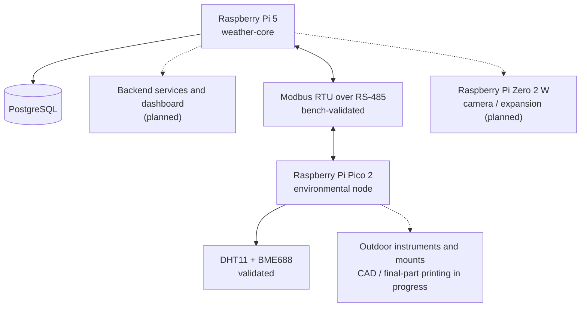

# Weather Station

<p align="center">
  <strong>An end-to-end environmental monitoring platform built around the Raspberry Pi ecosystem.</strong>
</p>

<p align="center">
  Embedded systems · Distributed telemetry · Backend engineering · Electronics · CAD
</p>

<p align="center">
  🚧 <strong>Active development — RS-485 integration and fabrication of final outdoor station parts</strong>
</p>

---

## Overview

Weather Station is a modular environmental monitoring platform combining embedded sensing, a wired RS-485 link, PostgreSQL telemetry, and custom outdoor hardware. The sensor/communication prototypes have progressed through repeatable validation; the project is now also in the fabrication and physical-integration stage.

A Raspberry Pi 5 acts as the central node, coordinating remote devices, persisting telemetry in PostgreSQL, and hosting the future backend services. Raspberry Pi Pico devices handle sensor acquisition close to the physical instruments, while a Raspberry Pi Zero 2 W is reserved for camera control, local processing, and other capabilities that require a Linux-based remote node.

The project is intentionally broader than a conventional hobby weather station. It is being developed as an end-to-end engineering system in which embedded software, electronics, mechanical design, networking, backend development, and data engineering must work together as one product.

---

## Why This Project Exists

The primary goal is not simply to measure temperature or humidity. The goal is to design and build a complete distributed system from first principles.

That includes deciding how devices communicate, how failures are detected, how measurements are validated, how state is persisted, and how physical components are protected from weather and maintained over time.

The project also serves as a practical learning and portfolio platform. Each subsystem introduces a different engineering problem:

- embedded control and sensor acquisition;
- reliable communication over constrained links;
- event scheduling and message prioritization;
- Linux services and backend architecture;
- time-series data modeling;
- electrical protection and power distribution;
- mechanical design and additive manufacturing;
- system recovery and long-term operation.

Rather than treating these as isolated exercises, the station provides a single product in which every decision has consequences across the full system.

---

## Architecture



The Raspberry Pi 5 (`weather-core`) is the central processing and persistence node. The Pico 2 handles hardware-facing sensing, maintains a Modbus RTU register map, and communicates with the Pi through a differential RS-485 transceiver. The P4 bench implementation uses SparkFun RS-485 breakouts, a 115200 8N1 link, and explicit half-duplex direction control.

Development progressed from direct UART and JSON telemetry (P1), to Modbus RTU over UART (P2/P3), to a **working RS-485 bench link (P4)**. Outdoor field wiring, multi-node operation, and long-term weather exposure are separate validation targets; the RS-485 link should not be mistaken for a commissioned outdoor bus.

The mechanical station is being fabricated in parallel with the electronics. The architecture remains modular so the environmental sensor, anemometer, wind vane, tipping-bucket rain gauge, mounting system, and future camera node can be developed and serviced independently.

---

## Telemetry and Device Communication

**Modbus RTU is the currently implemented telemetry and control protocol.** P2 established the frozen register-map v1.0 for the DHT11; P3 extended the environmental telemetry to **v1.1 (`0x0101`)** for the BME688. The same application contract is exercised over the P4 RS-485 physical link.

The Pico application is maintained in [`firmware/pico/`](firmware/pico/) as deployment profiles: [`profiles/bench/main.py`](firmware/pico/profiles/bench/main.py) is the RS-485 firmware validated on the P4 bench, and [`main.py`](firmware/pico/main.py) is its adaptation to the Pico 2 socket pin map (register map `0x0102`, DHT11 not installed), not yet validated on hardware. The Pi-side P4 [RS-485 Modbus client](experiments/rs485/rs485_modbus_client.py) includes bounded retries, reception resynchronization, request/response checks, a 5 ms inter-frame gap, and transport counters. Its RS-485 behavior was characterized in dedicated turnaround diagnostics under idle and CPU/I/O-loaded conditions. The remaining bus-level concerns are tracked in [`docs/next_steps.md`](docs/next_steps.md).

**ATP (Agnostic Telemetry Protocol)** is a separate, longer-term protocol effort motivated by the limitations of synchronous Modbus polling. The intended design includes device identity, heartbeats, prioritized faults, asynchronous events, and request/response correlation. A conceptual frame is:

```text
[dest_id][src_id][msg_type][seq][payload][checksum]
```

ATP is **not** described here as an installed replacement for the current Modbus/RS-485 implementation. Its future implementation and use in Weather Station will be documented when supported by completed code and integration tests.

See the [frozen P2 register-map specification](docs/phase_2/p2_modbus_register_map_v1.md), the [P3 environmental sensor mechanics specification](docs/phase_3/p3_07_bme688_removable_sensor_cartridge_spec.md), and the P4 implementation under [`experiments/rs485/`](experiments/rs485/).

---

## Design Principles

### Modularity

The system is divided into nodes and services with explicit responsibilities. A sensor, communication transport, storage implementation, or enclosure should be replaceable without requiring the entire station to be redesigned.

### Reliability

The station is intended for unattended operation. Communication failures, interrupted power, invalid measurements, and unavailable nodes are treated as normal operating conditions that the system must detect and handle.

### Observability

A functioning station must explain its own state. Device health, communication status, pending events, sensor failures, and power-related incidents should be visible rather than hidden inside logs or silent timeouts.

### Maintainability

The repository, hardware layout, protocol definitions, and deployment process are being documented as the project grows. The objective is not only to make the station work, but to keep it understandable months or years later.

### Reusability

Some components — particularly ATP, event scheduling, device coordination, and telemetry handling — are being designed so they can support future distributed embedded projects beyond weather monitoring.

---

## Core System

| Component | Current role / state |
|---|---|
| Raspberry Pi 5 — `weather-core` | Central Linux node; validated sensor telemetry acquisition and PostgreSQL persistence |
| Raspberry Pi Pico 2 (RP2350) | Sensor node running Pimoroni MicroPython, BME688/DHT11 drivers, Modbus RTU and RS-485 application firmware |
| PostgreSQL | Validated persistence for environmental measurements, sample sequences, and experimental run metadata |
| RS-485 | Validated with Pi 5 and Pico 2 on a bench; outdoor bus engineering and multi-node behavior remain open |
| Raspberry Pi Zero 2 W | Planned camera and expansion node; not part of the validated sensor pipeline |
| Fusion 360 | CAD reference models and mechanical design for sensor integration and printable outdoor structures |
| FDM 3D printing | **Final-part fabrication has started**; physical assembly and environmental qualification are still in progress |
| ATP | Future protocol work, not the active field-bus protocol |

---

## Environmental Monitoring

The primary environmental sensor in the validated P3/P4 node is the **Pimoroni BME688**, measuring temperature, relative humidity, atmospheric pressure, and raw gas resistance. A DHT11 is retained in the current firmware and test pipeline for comparison and historical validation.

The P3-06 run operated for **24.13 hours** (30–31 August 2026), collecting **17,372 complete paired acquisitions** at five-second intervals: 34,744 raw DHT11/BME688 records persisted in PostgreSQL, with no missing samples, Modbus errors, database errors, or sequence gaps. The [consolidated validation report](experiments/bme_688/pi/results/p3_06_consolidated_report_20260830_181710.txt) is kept as test evidence, not as proof of outdoor environmental accuracy.

The broader station also includes development of a **wind-speed instrument (anemometer), wind-direction instrument (vane), and tipping-bucket rain gauge**. These need calibration, bearing/water-ingress evaluation, and integrated installation. Their measurement accuracy and outdoor reliability have not been established by the BME688/DHT11 software tests.

Sensor placement matters as much as the electrical interface: the BME688 requires airflow, protection from direct radiation and water, drainage, access for cleaning, and thermal isolation from electronics. These are formalized in the [P3-07 removable-cartridge specification](docs/phase_3/p3_07_bme688_removable_sensor_cartridge_spec.md).

---

## Data and Backend

PostgreSQL is deployed on the Raspberry Pi 5 and has already been used for end-to-end telemetry experiments—not merely proposed. P1 demonstrated raw DHT11 measurements and a separately computed dew-point metric. P3 demonstrated 24-hour paired DHT11/BME688 acquisition, validation, JSONL audit logging, and database persistence.

The [P4 RS-485 long-run runner](experiments/rs485/p4_rs485_long_run.py) is implemented and reuses the validated P3 ingestion approach with an RS-485 transport client. Its existence does **not** imply that a corresponding long-duration P4 result has been completed and published.

A continuously operated production service, general-purpose API, dashboard, and complete device-management backend are future integration work. Running initially as native Linux processes and later considering containerization remain deployment options, not prerequisites for mechanical fabrication.

---

## Mechanical and Electronic Design

**The outdoor station has entered final-part 3D printing and physical integration**, alongside continuing electronics and software development. This is beyond CAD exploration and tolerance coupons, but **does not mean the complete instrument assembly has been installed or qualified outdoors**.

The mechanical concept discussed for the first integrated station uses a mast-mounted **V-shaped instrument support**, with wind-speed and wind-direction instruments on one arm and the rain gauge and radiation shield on the other. The geometry supports service access, especially to the rain gauge. Final configuration and individually completed prints should be established from manufacturing records rather than inferred from an earlier design concept.

The environmental sensing assembly is based on the frozen [P3-07 BME688 removable-cartridge requirements](docs/phase_3/p3_07_bme688_removable_sensor_cartridge_spec.md), including mechanically reversible mounting, airflow, rainfall/droplet protection, and thermal separation from the electronics.

Current engineering areas include:

- outdoor-suitable printed materials and print-process validation (including ASA and PETG where appropriate);
- fits, inserts, fasteners, and dimensional tolerances for serviceable printed parts;
- rotation mechanisms, bearings, rain ingress, and maintenance of the wind instruments;
- tipping-bucket rain gauge mechanics and eventual calibration;
- enclosure protection, strain relief, 24 V distribution, cable routing, and RS-485 bus bias/termination before outdoor deployment.

### Outdoor electronics box

The outdoor node lives in a commercial IP66/IP67 enclosure with a factory gasket; printed parts are not trusted to keep water out. Inside, the electronics are arranged on two levels:

- **Level 1, on the enclosure's original perforated mounting plate:** the PWR-DIST Rev A board (protected 24 V input split into fused branches) and the Pololu 5 V buck converters. The plate was measured and modeled parametrically in Fusion (135 × 185 × 3.05 mm, 5 mm hole pitch), so printed parts are placed on known hole positions.
- **Level 2, on a printed deck above it:** the Pico 2 in a plug-in socket, the two SparkFun RS-485 breakouts, and the box-temperature sensor. The deck is still being modeled.

The **Pico 2 socket** turns the Pico into a replaceable module without soldering on the board: crimped Dupont housings on the Pico pins route to eight JST receptacles (RS-485, BME688, wind vane, power, box temperature, anemometer, rain gauge, and a wired spare). A stacked 3V3/GND bus ladder distributes power under the Pico, and a hinged frame, pinned with 1.75 mm filament, retains it.

Fastener use is deliberately minimal and drawn from the M2–M3 kit already owned: through-bolts with nuts on the mounting plate, self-tapping M2 screws for small boards, and heat-set inserts on the printed deck.

### CAD and manufacturing files

Fusion 360 is the CAD design environment. The repository separates editable source ([`hardware/cad/source/`](hardware/cad/source/)), versioned printable exports ([`hardware/cad/exports/`](hardware/cad/exports/)), and printer-specific slicer/G-code files, which stay outside Git.

| Release | Contents | State |
|---|---|---|
| [`outdoor-box/2026-11-09-box-print-set`](hardware/cad/exports/outdoor-box/2026-11-09-box-print-set/) | STL for the Pico 2 socket v4 (body, cover, retention frame, post blocks, bus ladder tray v2), the buck A/B, Grove and RS-485 holders, and the PWR-DIST spacers, with quantities, fasteners and print settings | Released for printing; fit in the enclosure and outdoor exposure not yet qualified |

The editable Fusion source (`.f3d`/STEP) for these parts has **not yet been published**. The instrument hardware (anemometer, wind vane, rain gauge, radiation shield and mast support) is not part of any published release yet.

---

## Repository Structure

```text
weather-station/
├── backend/
│   └── database/               # Experimental PostgreSQL schemas and queries
├── docs/
│   ├── phase_1/
│   ├── phase_2/
│   ├── phase_3/
│   ├── next_steps.md
│   └── pico_provisioning.md
├── experiments/
│   ├── dht_11/
│   ├── modbus/
│   ├── bme_688/
│   └── rs485/
├── firmware/
│   ├── pico/                   # Pico application profiles (socket, bench, uart) and dependency lock
│   └── zero/                   # Reserved for future expansion
├── hardware/
│   └── cad/
│       ├── source/             # Editable CAD (not yet published)
│       └── exports/            # Versioned STL releases (outdoor-box print set)
├── infrastructure/
├── tests/
├── tools/
│   └── picoctl.py             # Interactive one-command Pico provisioning
├── CHANGELOG.md
└── README.md
```

| Directory | Purpose |
|---|---|
| `firmware/pico/` | Pico 2 application profiles (socket, validated bench, historical UART), sensor drivers, and `dependencies.lock.json` |
| `tools/` | Host-side provisioning (`picoctl.py`: deploy, push, status, backup) |
| `tests/` | Automated tests, including installer regressions |
| `experiments/` | Historical experiments, field-bus diagnostics, end-to-end runners, and retained validation evidence |
| `backend/database/` | Test and prototype database models and SQL |
| `docs/` | Engineering specifications, installation procedures, phase evidence, and deferred decisions |
| `hardware/cad/` | Printable STL releases with part lists and print settings; editable CAD source to follow |
| `firmware/zero/`, `infrastructure/` | Expansion and deployment scaffolding; not evidence of completed runtime services |

### Pico 2 provisioning

A replacement Pico 2 can be provisioned from the repository root with one command:

```powershell
python tools/picoctl.py
```

The installer detects the Pico's port and the profile already installed on it (`socket`, `bench` or `uart`), so a reinstall asks nothing; `--profile` switches to another wiring. It backs up the Pico's filesystem, installs pinned `micropython-modbus` and the application modules, and verifies transferred files and imports. It keeps a verified copy of the known-good Pimoroni MicroPython UF2 **on the host PC**; it never flashes it.

Every deployment is recorded on the Pico (`/ws_deploy.json`: profile, Git commit and the SHA-256 of every file) and in a log on the PC. `picoctl push` copies individual experiment scripts with the same backup, read-back and record, and `picoctl status` shows whether the Pico still matches its record and the repository.

The original installer was validated on a physical Pico 2 (COM12) with a verified 15-file backup and passed post-install integrity checks. The profiles, deployment record, `push` and `status` are covered by host tests against a simulated Pico and still need a run on hardware. Dependency versions and hashes are maintained in [`firmware/pico/dependencies.lock.json`](firmware/pico/dependencies.lock.json). The [provisioning guide](docs/pico_provisioning.md) contains the full workflow.

---

## Development Method

The project uses incremental validation rather than treating a functioning prototype as a completed field installation. Experimental results are retained in `experiments/`; proven device code is promoted into `firmware/`; mechanical requirements, reproducible configurations, and deferred engineering decisions are documented alongside their evidence.

P1 validated direct UART, P2 validated the Modbus control contract, P3 validated BME688 telemetry and database persistence, and P4 established the half-duplex RS-485 bench implementation and its timing requirements. Physical manufacturing can proceed concurrently, while field-bus commissioning, sensor calibration, and long-term outdoor operation remain separate acceptance stages.

For the active technical debt and its test evidence, see [`docs/next_steps.md`](docs/next_steps.md).

---

## Current Status

**As of November 2026:** the work is transitioning from sensor/communication experiments to **physical fabrication, subsystem integration, and preparation for outdoor deployment**.

| Workstream | Status | Evidence / remaining boundary |
|---|---|---|
| **P1 — Pi↔Pico UART + DHT11** | Complete | 23 h 25 min continuous run; validated ingestion, liveness, and reconnection |
| **P2 — Modbus RTU contract** | Complete | Frozen v1.0 register map and 19/19 integration tests |
| **P3 — BME688 environmental acquisition** | Complete | v1.1 (`0x0101`) register map; P3-06 24.13-hour run, 17,372 paired acquisitions, no losses; P3-07 mechanical requirements frozen |
| **P4 — RS-485 communication** | Bench-validated; socket firmware not yet validated | Half-duplex Pi 5↔Pico 2 testing, turnaround diagnostics, client with retries and counters, P4 long-run **runner implemented**; no long-duration P4 report published in this repository |
| **Pico 2 provisioning** | Complete; traceability extension pending hardware run | One-command installer, pinned UF2/dependencies/`mpremote`, hardware-proven backup and upload; wiring profiles, on-device deployment record, `push` and `status` tested against a simulated Pico (42 automated tests) |
| **Outdoor mechanical fabrication** | In progress | Outdoor-box print set (Pico 2 socket v4, board holders, PWR-DIST spacers) published as STL on 2026-11-09; level-2 deck, instrument hardware, editable CAD source and assembly qualification remain open |
| **Outdoor wiring and protection** | Not field-qualified | Power distribution, bus bias/termination, weatherproofing and environmental exposure validation still needed |
| **Production backend / dashboard** | Planned | Experimental storage is working; unattended production services and user interface are separate work |
| **Camera node / ATP** | Future | Neither is part of the commissioned station or validated P4 pipeline |

**What is not being claimed:** a finished outdoor installation, validated wind/rain calibration, P4 long-term field stability, or an operational camera node.

The next useful integration steps are to complete and document the first assembled sensor/instrument modules, validate the outdoor electronics and RS-485 wiring, and carry the proven acquisition chain into the physical station.

---

## Roadmap

The phase labels below follow the validated P1–P4 milestones and separate mechanical production from software experiments. They describe progress, not a claim that all sub-tasks within a phase have closed.

| Stage | Scope | Status |
|---|---|---|
| P1 | Initial Pi–Pico UART sensing and database pipeline | Complete |
| P2 | Modbus RTU contract and frozen register map | Complete |
| P3 | BME688 integration, environmental data validation and sensor-cartridge specification | Complete |
| P4 | RS-485 bench link, diagnostics, multi-node and long-duration robustness | Bench validation done; further integration open |
| Outdoor fabrication and integration | Printable sensor structures, moving mechanisms, wiring, enclosure, mounting and calibration | **Final-part printing underway** |
| Production services | Unattended ingestion, device management, API, dashboard and monitoring | Future |
| Expansion | Camera node, additional devices, external services, ATP integration and analytics | Future |

Deferred technical requirements and their triggers are tracked in [`docs/next_steps.md`](docs/next_steps.md). A dedicated consolidated roadmap file has not yet been published in this repository.

---

## Technology Stack

| Area | Technology |
|---|---|
| Central operating system | Raspberry Pi OS |
| Backend | Python |
| Embedded development | MicroPython, with C/C++ considered where needed |
| Database | PostgreSQL |
| API | FastAPI, planned |
| Communication | UART and Modbus RTU over RS-485 (validated on bench); Wi-Fi and ATP for future expansions |
| Development environment | Visual Studio Code Remote SSH |
| Version control | Git and GitHub |
| Mechanical design | Fusion 360; ASA parts printed on an Elegoo Centauri Carbon 2 (single material) |
| PCB design | Fusion 360, planned |
| Deployment | Native Linux services initially; Docker to be evaluated later |
| Visualization | Web dashboard, planned |

---

## Documentation

Technical documentation will live under `docs/` rather than expanding the root README indefinitely.

It will include the protocol specification, system architecture, database design, power distribution, wiring, device roles, hardware decisions, deployment procedures, recovery processes, and the complete roadmap.

The README is intended to remain the entry point: it explains what the project is, why its architecture exists, what has already been built, and where to find deeper technical material.

Notable changes across the project are tracked in [`CHANGELOG.md`](CHANGELOG.md). The README is an overview rather than a source of detailed hardware-build records: each STL release under `hardware/cad/exports/` carries its own part list, quantities and print notes. Photographs of printed and assembled parts have not yet been added.

---

## Gallery

Photographs, diagrams, CAD renders, printed components, electronic assemblies, communication tests, and dashboard screenshots will be added as the physical system develops.

---

## Project Scope

This is currently a personal engineering and portfolio project under active development.

The architecture is being designed with reliability and reuse in mind, but the system is not yet production-ready and should not be used for safety-critical monitoring or as a certified source of meteorological observations.

---

## License

This project is licensed under the [Apache License 2.0](LICENSE).

Copyright © 2026 PDJ-E